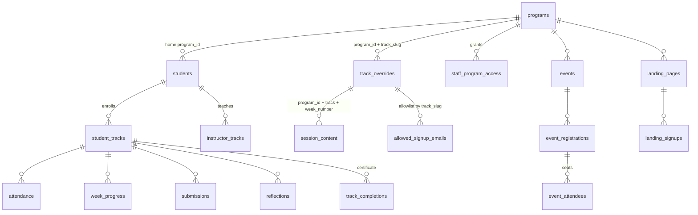
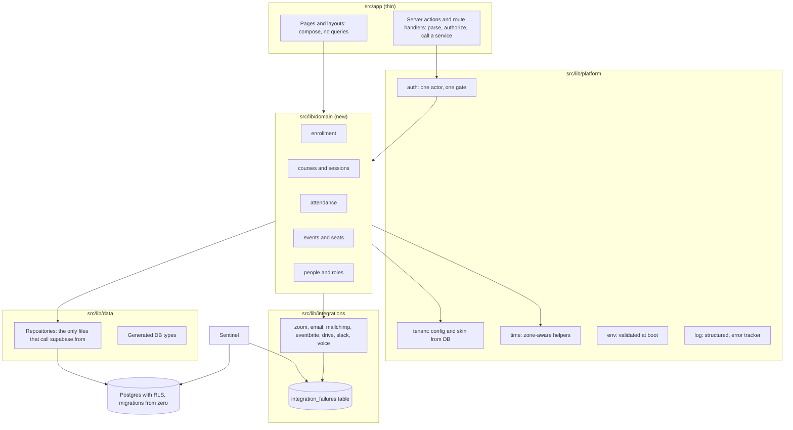

# Architecture review: bcc-academy-lxp

Reviewed at `2ab1615e` on 2026-11-12. Static review only: grep, file counts, targeted reads, git history. No build, no tests, no database, no browser. Where something was not checked, it says so.

## Verdict

It is a working product with a real spine, wrapped in a pile of patches. The spine is good: one program-resolution path, one capability gate (`requireCapability`, `src/app/dashboard/admin/actions-shared.ts:16`), one Supabase client pair, a nightly self-audit (Sentinel), a post-deploy probe, RLS switched on for every table. Those are decisions a system makes.

Everything around the spine was added one feature at a time, by one person, at about 8 commits a day (1,533 commits in 6 months), with no layer between the page and the database. The result is that the rules of the product live in 1,000-line page files and 55 action files, the database cannot be rebuilt from the repo, production errors go to `console.error` and nowhere else, and tenant identity is hardcoded in 34 `slug === "..."` branches. A second engineer could not inherit this safely today. A paying white-label customer would hit the hardcoding inside the first week.

None of this is unusual for a product at this stage, and none of it needs a rewrite. It needs about six conventions and the discipline to route new work through them.

## Scorecard

| # | Area | Grade | Why |
|---|---|---|---|
| 1 | Coherence | C | One client factory and one capability gate, but no validation library, no date helper (397 `new Date(`), two icon libraries, 12 locally defined gate helpers |
| 2 | Domain model | C- | The core `students` table is not in migrations; a course is called track, course, and program in different places; tenant rules live in TS configs and slug conditionals |
| 3 | Layering | D+ | 546 direct table queries in `src/app` against 296 in `src/lib`; 49 page and layout files query the database themselves; 50 files over 400 lines |
| 4 | Integrations | C | Each integration has its own module, but 2 timeouts across 40 `fetch` calls, no retries, no failure queue, and failures are logged then dropped |
| 5 | Data and DB | C- | RLS is on everywhere, indexes and FKs exist, but 110 of 129 migrations have no ordering, three tables have no `CREATE`, there is no seed and no generated types |
| 6 | Reliability and ops | D+ | No error tracker, 113 bindingless `catch` blocks, env never validated, rate limiter is per-instance memory, CI runs no lint and no build |
| 7 | Security | C+ | Detail held back from this public branch |
| 8 | UX system | C | `DESIGN.md` and 8 primitives exist; there is no Button component (361 raw `<button>` in 147 files) and 330 arbitrary pixel font sizes |
| 9 | Performance | C (provisional) | Not measured. 99 files force dynamic rendering, zero data caching, and a 5-minute keep-warm cron is covering for it |
| 10 | Testability | C | 99 test files, but 41 of them cover one subsystem (`lib/mvp`); auth has 2; the README is the `create-next-app` template; bus factor is 1 |
| 11 | Frankenstein | C- | Five pitch-page routes, an `archive/` folder, a v1 and v2 exam file, three hardcoded apply forms beside the dynamic one, 7 unused tables |

## 1. Coherence

**Data fetching. Dominant pattern: Server Component or server action calls Supabase directly.** There is one client pair, `createClient` and `createServiceClient` (`src/lib/supabase/server.ts:13`, `:46`), which is good. The problem is who calls them: 203 files contain a `.from("table")` query. Only one data cache exists in the whole app (1 `export const revalidate`, 0 `unstable_cache`, 7 React `cache()` uses), and 99 files declare `force-dynamic`. 14 client-side `fetch("/api/...")` calls in 12 files form a second, smaller pattern. Outliers to migrate: the client fetches that could be server actions.

**Validation. There is no pattern.** Zero zod imports. Server actions take typed arguments from the client and trust the types; the MVP module is the exception and takes `input: unknown` and validates (`src/app/dashboard/admin/mvp/attendance-actions.ts:8`). That exception is the right model. Forms: 37 files use `onSubmit`, 24 use `useTransition`, 3 use `<form action>`, 0 use `useActionState`.

**Dates and time zones. No library, no helper.** 397 `new Date(` calls, 106 `toLocale*String` calls, 42 inline `timeZone:` options, and `"America/New_York"` hardcoded 30 times in 22 files. Formatting helpers exist in only two files (`src/lib/utils.ts`, `src/lib/workshops.ts`). Every DST bug and every non-Eastern tenant will be found one screen at a time.

**Auth checks. Dominant: `requireCapability` and its aliases** (`requireAdmin` 39 uses, `requireManager` 42, `requireSuperAdmin` 14). Outliers: `requireMaster` is defined three separate times (`organizations/actions.ts:15`, `actions-access.ts:23`, `health/actions.ts:17`), `requireSuperAdmin` is redefined in `features/actions.ts:7` beside the shared one, and there are further local gates (`requireReviewer`, `requireLibrarian`, `requireCourseCreator`, `requireAllowlistActor`, `requireLandingManager`, `requireAuth`, `requireUserId`, `requireEnrolledLearner`, `requireExamAccess`). 28 files call `auth.getUser()` directly and 7 files compare `role === "admin"` inline.

**API clients.** Email is centralized in `src/lib/email.ts` except two bypasses that construct their own Resend client: `src/app/dashboard/admin/actions-surveys.ts:327` and `src/app/api/quiz/results/route.ts:10`.

**Styling.** Tailwind tokens are dominant (313 uses of the primary token). Outliers: 394 inline `style={{` in 73 files, 198 hex literals in 52 `.tsx` files, 330 `text-[Npx]` arbitrary sizes despite the documented type ramp.

**Icons.** Phosphor is declared the standard and is in 80 files; lucide is still in 46.

**Naming.** The unit a learner enrolls in is `track` in the schema (`track_slug` 27 columns, `track` 5, `track_id` 1), `course` in the UI and admin (331 files), and overlaps with `program` (461 files). A unit of content is `week` in the schema (`week_number`) and `session` in the UI. The tenant key is `program_id uuid` in 48 columns, `program_slug text` in 6, and `program uuid` in 2. Pick one word per concept and write it down; the code can keep the old column names behind a mapping.

## 2. Domain model

Relationships between a course and its children are by text slug, not foreign key, so the diagram above is what the code assumes rather than what the database enforces.

**Is it clean?** No. Specific problems:

- `students` is user, profile, role, staff flag, home program, and cohort in one row, and it has no `CREATE TABLE` in the repo. It is the most-queried table (124 call sites).
- A course exists in up to three places: a TypeScript config (`src/lib/programs/*.ts`, 3,802 lines, for example `beyond-code-centers.ts` at 490), a `track_overrides` row, and `hidden_courses`. `src/lib/programs/server.ts` (523 lines, 43 changes in 6 months) exists to merge them. CLAUDE.md already calls the TS configs legacy; they are still load-bearing.
- "Cohort" is three things: a `cohorts` table (queried at `src/app/dashboard/admin/page.tsx:349`, no `CREATE` in migrations), a text column on students, and `program_variant` on survey responses.
- Enrollment uniqueness is `(student_id, track_slug)` without `program_id`, while `instructor_tracks` and `track_completions` include it. The same slug in two programs collides. This is already a documented gotcha; for multi-tenant it is a blocker.
- Role is a column on `students`, plus `staff_program_access` grants, plus four env-var email lists (`MASTER_EMAILS`, `SUPER_ADMIN_EMAILS`, `ADMIN_EMAILS`, `STAFF_EMAILS`), plus a `staff_emails` table. Five sources for "what can this person do".

**Where state drifts:** TS config against `track_overrides`; allowlist against invites against accounts (the go-live checklist exists because of this); attendance from learner self-report against the Zoom import; completion from `track_completions` against derived `week_progress`.

**White-label readiness: not ready.** Evidence:

- 34 `slug === "..."` conditionals. `src/app/dashboard/layout.tsx` has 7, including `program.slug === "bgc"` driving navigation and a `campMode` prop (`:750`, `:811`, `:828`, `:835`, `:1004`). `src/app/dashboard/admin/page.tsx` has 5 (`:203`, `:861`, `:864`).
- `bccacademy.io` appears 159 times in 84 files. "Beyond Code" appears 174 times in 72 files. The brand color `#1D59FF` is hardcoded 61 times in 36 files.
- Tenant-specific routes exist as code: `/apply/home-for-summer`, `/apply/sbft`, `/apply/security-plus`, `/dashboard/mass`, `/dashboard/techplus`.
- Mailchimp sync is gated by a hardcoded set of three program slugs (`src/lib/mailchimp.ts:13`) and uses one global audience ID.
- One Resend sender, one Zoom account, one Drive folder, all global env vars. A tenant cannot bring its own.

## 3. Layering and boundaries

There is no domain layer. The split is:

| Location | Direct table queries |
|---|---|
| `src/app/dashboard` | 417 |
| `src/app` total | 546 |
| `src/app/api` | 64 |
| `src/lib` | 296 |
| `src/components` | 1 |

Components are clean, which is worth keeping. Pages are not: 49 `page.tsx` and `layout.tsx` files run their own queries, and the largest carry the business rules for the screens they render: `dashboard/track/[slug]/[week]/page.tsx` (1,240 lines), `dashboard/page.tsx` (1,122), `dashboard/admin/page.tsx` (1,051), `dashboard/layout.tsx` (1,019). A layout that is 1,019 lines long is doing enrollment resolution, program healing, navigation policy, and tenant branching on every request.

The service-role client is called 239 times in 147 files. In practice the app reads and writes as the database superuser almost everywhere, so RLS is a backstop for direct PostgREST access and nothing else. Authorization is whatever each action remembered to check. This is the single most important structural fact in the codebase. Scope helpers exist (`assertTrackInActorProgram` 11 uses, `assertStudentInActorProgram` 3, `assertApplicationInActorProgram` 4), which shows the pattern is known; it is applied by hand, per action.

`"use client"`: 198 of roughly 660 source files. Not alarming as a ratio. The concern is size: `survey-wizard.tsx` (2,188 lines), `fde/session-stage.tsx` (1,996), `help/help-center.tsx` (2,076), `landing-form.tsx` (1,128) are client bundles.

God files: 50 over 400 lines. The churn list and the size list are the same list, which is where bugs concentrate:

| File | Lines | Changes, 6 months |
|---|---|---|
| `dashboard/admin/admin-tabs.tsx` | 804 | 212 |
| `dashboard/admin/page.tsx` | 1,051 | 107 |
| `dashboard/layout.tsx` | 1,019 | 98 |
| `dashboard/page.tsx` | 1,122 | 96 |
| `dashboard/track/[slug]/page.tsx` | 674 | 92 |
| `dashboard/track/[slug]/[week]/page.tsx` | 1,240 | 85 |
| `components/nav.tsx` | 867 | 65 |
| `auth/callback/route.ts` | 604 | 60 |
| `lib/email.ts` | 1,495 | 46 |

Dependency direction has one visible inversion: an API route imports its gate from an admin page folder (`src/app/api/certificates/[id]/pdf/route.ts:2` imports `@/app/dashboard/admin/actions-shared`), as does `events/new/actions.ts:5`. The gate belongs in `src/lib/auth`. Circular dependencies were not checked (that is a Phase 3 tool run).

## 4. Integrations

What actually exists: Supabase, Resend, Zoom (SDK join, attendance report import, recording import), Mailchimp (one-way subscribe), Eventbrite (webhook and claim), Google Drive (certificate filing), Slack (DM digest), ElevenLabs (voice), Pexels (media), web push, Vercel Blob and AI Gateway.

**Salesforce and Hivebrite are not integrated.** The 12 files that mention them are marketing copy, course catalog text, and an events CSV import format (`src/lib/events-import.ts`). I did not read each mention line by line. There is no WordPress remnant in `src` (zero matches). So the "registration to Mailchimp to Salesforce to attendance" pipeline in the brief does not exist as a pipeline. What exists is:

1. Sign-up or enrollment writes `students` and `student_tracks`.
2. Mailchimp subscribe fires as a side effect from five call sites (`auth/callback/route.ts:457` inside `after()`, `lib/email.ts:981`, `admin/actions-students.ts`, `survey/[id]/actions.ts`, `apply/home-for-summer/actions.ts:48`).
3. Attendance arrives separately, from learner self-report (`/api/attendance`) and the nightly Zoom report import.

**Failure modes:**

- Mailchimp down or misconfigured: the error is logged and the function returns (`src/lib/mailchimp.ts:37`, `:75`, `:78`). The subscriber is silently lost. No record of the miss, no retry. It is idempotent (PUT by email hash), so a backfill job would be safe; none exists.
- Zoom attendance: idempotent upsert on a 5-column key (`src/lib/attendance/zoom-sync.ts:170`). Good. It imports "yesterday" only, so a failed night is a lost night unless someone reruns it by hand.
- Eventbrite webhook: authenticated by a shared secret in a query string or header, and skipped entirely if the env var is unset (`src/app/api/eventbrite/webhook/route.ts:50`). It then fetches the `api_url` from the payload.
- Timeouts: 2 uses of `AbortSignal`/`AbortController` in the whole codebase against 40 `fetch` calls in 26 files. A slow Zoom or Drive response holds a function open until the platform kills it.
- Retries and queues: none. Cron reruns are the only retry.

Adapters: each integration does have its own module, and callers mostly go through it. That part is fine. What is missing is a shared wrapper (timeout, one retry, a failure row) and a single status view. Sentinel is the natural home for the status view and already runs nightly.

## 5. Data and DB

- **Migrations are not reproducible.** 19 of 129 files have a timestamp prefix. The other 110 are named by topic (`allowlist_names.sql`, `allowlist_per_track.sql`) with no order. `_catch_up.sql` describes itself as a consolidation of every file into one idempotent block to paste into the SQL editor, and `_audit_probe.sql` is its companion. `students`, `cohorts`, and `track_features` are never created. You cannot stand up a fresh database from this repo, which means you cannot run integration tests, cannot give a customer their own instance, and cannot prove what production looks like.
- **Drift against the live schema: not checked** (prod is off limits for this audit). Given the above, assume it exists.
- **Seed:** none. Test data is made by one-off scripts (`make-fde-test-student.mjs`, `make-forte-test-student.mjs`, `make-mass-test-student.mjs` and three matching cleanup scripts).
- **Types:** no generated Supabase types. Row shapes are hand-written at call sites, hence 42 `as unknown as` casts in 31 files.
- **RLS:** enabled on all 60 created tables, 75 policies. Policies were not tested in this phase.
- **Error handling on queries:** 322 queries in 139 files destructure `{ data }` and ignore `error`; 74 in 44 files check it. A failed read renders as an empty state.
- **Unbounded reads:** 105 `.limit`/`.range` calls across 53 files against 203 files that query. Roster, survey, and analytics reads are the likely unbounded ones; PostgREST silently caps at 1,000 rows, which turns into wrong totals at scale. Not verified per query.
- **Invariants:** 41 unique constraints and 124 FK references is respectable. Event seats go through SQL functions (`register_event_attendees`, `offer_waitlist_seats`), which is the right place. Whether those functions lock correctly under concurrent registration was not verified.
- **Soft delete:** inconsistent. `hidden_courses` is a separate table, three tables use `archived_at`, one uses `hidden_at`, and one table is dropped outright.
- **Audit trail:** `admin_access_log` and `ta_changes` exist. The access log is fire-and-forget by design (comment at `actions-shared.ts:57`).
- **Backups and restore:** nothing in the repo. Whatever the Supabase plan provides.

## 6. Reliability and ops

- **Could you debug a production incident at 2am? Only with the Vercel log viewer and luck.** There is no error tracker and no request ID. Logging is 225 `console.error`, 36 `console.warn`, bracket-prefixed by convention.
- **Swallowed errors:** 113 `catch {` blocks with no binding in 84 files, and 28 `.catch(() => {})`. Many are deliberate degradations with comments. The pattern still means failures are invisible by default.
- **Config:** 49 env vars, read in 59 files, never validated at boot. 25 are missing from `.env.local.example`.
- **Rate limiting:** an in-process `Map` (`src/lib/rate-limit.ts:11`). On serverless each instance has its own counters.
- **Cron:** 10 jobs, all with the same bearer check, copy-pasted into each route rather than shared. Zoom attendance and certificates are idempotent. There is no record of whether a job ran; Sentinel is the only thing that would notice.
- **CI:** typecheck and unit tests only. The workflow file states that lint is excluded because `pnpm lint` crashes the Node heap and `eslint src` reports 185 existing errors (`.github/workflows/ci.yml`, comment block after the US English step). There is no `next build` gate. Smoke tests are documented as usually red and non-required.
- **Strengths worth naming:** Sentinel (`src/lib/sentinel/checks.ts`, 556 lines of data invariants), the deploy-check hook, the CSP report sink, the `/auth/confirm` interstitial. Someone has been burned and built the right alarm each time. They are point alarms, not a system.
- **Rollback:** Vercel instant rollback for code. No down migrations, so a schema change is one-way.

## 7. Security

Held back from this public branch; tracked privately.

## 8. UX system consistency

- Tokens and a type ramp are documented in `DESIGN.md`. Enforcement is by memory: 330 `text-[Npx]` arbitrary sizes, 198 hex literals in 52 files, 394 inline styles.
- Primitives: `src/components/ui.tsx` exports 8 (Panel, Field, DataTable, PersonCell, Num, SegmentedTabs, BackLink, SaveIndicator), plus `page-header.tsx`, `catalog-card.tsx`, and the stats kit.
- **There is no Button.** 361 raw `<button>` elements in 147 files, each with its own class string. Also 235 raw `<input>`, 53 raw `<select>`, 16 hand-built tables beside `DataTable`, and 8 separately built dialogs.
- Radii in use: `rounded-full` 319, `rounded-lg` 305, `rounded-xl` 37, `rounded-md` 23, `rounded-2xl` 13, and four arbitrary values.
- State coverage: 6 `loading.tsx` and 4 `error.tsx` for 104 pages. All public routes share the single root error boundary. Empty states were not surveyed.
- i18n: none. Every string is inline English. Spanish would be a full extraction project. There is a US-English spelling guard in CI, which tells you where the effort has gone.
- Accessibility: 177 `aria-label`s, global focus-visible rule per project notes. No axe run in this phase.
- Collapse list: Button (primary, secondary, ghost, danger), Input, Select, Dialog, and move the 16 raw tables onto `DataTable`.

## 9. Performance (not measured)

No build, bundle analysis, or Lighthouse was run; this is a read of the code only.

- 99 files force dynamic rendering and there is effectively no data cache. Every dashboard request recomputes the 1,019-line layout plus the page, each with its own queries. `React.cache` is used in 7 places, so some request-level dedupe exists.
- `/api/warm` every 5 minutes (and a `warm-eu` route) exists to mask cold starts. That is a cost and a signal.
- Images: `next/image` in 10 files, raw `` in 2. Video: 9 files with `<video>`, hero videos up to 40 MB per a config comment (`next.config.ts:21`). `public/` is 21 MB.
- Heavy client code: Zoom Meeting SDK, TipTap, framer-motion, `@react-pdf/renderer`, and the 2,000-line client components named in section 3. Whether these are code-split was not checked.
- No edge runtime anywhere. 2 routes set `maxDuration`.

## 10. Testability and maintainability

- Core logic can be tested without a network only where it was extracted to `src/lib`. The MVP module proves it: 41 test files for one feature. Everything that lives in a page file cannot be unit tested at all.
- Pyramid: 99 unit test files, 7 smoke specs, 2 QA specs. Distribution is lopsided: `lib/mvp` 41, `app/dashboard` 17 (12 of them MVP), `lib/surveys` 7, `lib/auth` 2, `lib/programs` 2, `app/api` 1. No test file sits beside enrollment, invites, attendance write, certificates issue, or the auth callback (604 lines, 60 changes in 6 months).
- No database test harness, because no reproducible schema.
- Docs: `README.md` is the unmodified `create-next-app` template. `AGENTS.md` setup instructions point at `/Users/fonz.morris/fonz.sh/bcc-lxp`, a path that no longer exists. `CLAUDE.md` is the real onboarding document and it is good. `docs/` has 68 files of unknown freshness. No ADRs.
- Bus factor: 1. Of 1,533 commits in 6 months, 1,363 come from one person under two git identities, 152 from an org account, 16 from one other contributor.
- Debt markers: 0 TODO, 0 FIXME, 0 HACK, 0 `@ts-ignore`. 40 `eslint-disable` in 22 files (`nav.tsx` 7, `landing-view.tsx` 6), 11 `as any`, 42 `as unknown as`. The absence of TODOs is less clean than it looks: the debt is recorded in comments and in memory notes, not in markers.

## 11. Frankenstein detector

- **Pitch material shipped as product routes:** `/platform`, `/platform-atlas`, `/platform-brief`, `/platform-features`, `/platform-map`.
- **Repo as filing cabinet:** `archive/` (52 files including a `marketing-v0.1` app), `demo/`, `learnerpathwayassessmenttoolbuildpacket/`, `qr-codes/`, two screenshots, three HTML one-sheets, a PDF, a board meeting script, all at the root.
- **v1 beside v2:** `src/lib/exams/network-plus-post.ts` (993 lines) and `network-plus-post-v2.ts` (982 lines).
- **Hardcoded beside dynamic:** `/apply/home-for-summer`, `/apply/sbft`, `/apply/security-plus` next to `/apply/[slug]`; `/dashboard/mass` and `/dashboard/techplus` next to DB-driven courses; TS program configs next to `track_overrides`.
- **Different eras of style:** the MVP module (strict input validation, tests first, explicit DTOs) reads like a different codebase from the admin tabs it sits beside. The FDE session stage is a third style. The MVP style is the one to standardize on.
- **Schema without code:** 7 `lpat_*` tables with no reference in `src`.
- **Code without a trigger:** `/api/warm-eu` is not in `vercel.json`. `/api/quiz/results` is permanently disabled by a constant.
- **Eventbrite:** 29 files still reference it. Whether the funnel is live or a remnant is a product question for Phase 2.
- **Stale instructions:** `AGENTS.md` paths.

Reachability of each of these from the UI was not traced; that is Phase 2 work.

## Top 10 structural risks

Ranked by likelihood times blast radius.

| # | Risk | Likelihood | Blast radius |
|---|---|---|---|
| 1 | A server action misses a tenant scope check and leaks or edits another program's learners. Nothing below the app layer prevents it (239 service-client calls, 172 actions). | High | Minors' PII across tenants |
| 2 | The database cannot be rebuilt from the repo. A bad manual migration, a restore, or a second customer instance has no known-good definition. | High | Whole platform |
| 3 | Production failures are invisible: no error tracker, 322 ignored query errors, 141 silent catches. Incidents are found by users. | High | Every cohort launch |
| 4 | One person holds the system in their head. | Certain | Continuity |
| 5 | White-label customer hits hardcoded BCC/BGC behavior (34 slug branches, 159 domain literals, global sender and Zoom account). | High if sold | That contract |
| 6 | Held back from this public branch | | |
| 7 | Held back from this public branch | | |
| 8 | Time-zone logic is duplicated 30 times; a DST change or a non-Eastern tenant breaks join gating, reminders, or attendance dating. | Medium | A live session day |
| 9 | The churn hotspots (the five dashboard files) keep growing and regress, with no tests around them and no lint or build gate in CI. | High | Learner and admin home |
| 10 | Integration failures drop data silently (Mailchimp subscriber lost, missed Zoom night never retried). | Medium | Reporting and funder numbers |

## Target architecture

The conventions that enforce this are in `CONVENTIONS.md`.

## Refactor roadmap

### Quick wins (under a day each)

| # | Item | Size | Do it first because |
|---|---|---|---|
| 1 | Held back from this public branch | S | |
| 2 | Held back from this public branch | S | |
| 3 | Add an error tracker and wire `src/app/error.tsx`, `dashboard/error.tsx`, and one `logError` helper | S | Everything after this is safer once failures are visible |
| 4 | Validate env at boot in one `env.ts`; complete `.env.local.example` | S | Stops silent degradation |
| 5 | Replace the README; fix the paths in `AGENTS.md` | S | Bus factor |
| 6 | Move `requireCapability` and friends to `src/lib/auth`, delete the 3 `requireMaster` copies and the duplicate `requireSuperAdmin` | S | One gate before more actions are written |
| 7 | Fix the ESLint config so it lints `src` only, baseline the 185 errors, add lint and `next build` to CI | S | Stops new debt at the door |
| 8 | Move `archive/`, `demo/`, packets, screenshots, and one-sheets out of the repo | S | Noise; needs your approval per file |

### Foundation (1 to 2 weeks)

| # | Item | Size | Because |
|---|---|---|---|
| 9 | Baseline the schema: dump the live schema to one timestamped migration, archive the 110 unordered files, adopt timestamped migrations only, generate types | M | Unblocks tests, types, and a second instance |
| 10 | Add a seed script and a local Supabase test harness; write RLS and tenant-scope tests for the 10 most sensitive tables | M | Risk 1 becomes testable |
| 11 | Shared rate limit store (Upstash or a Postgres table) | S | Risk 7 |
| 12 | `time.ts`: one program time zone source, one set of formatters; migrate the 22 files | M | Risk 8, and a white-label prerequisite |
| 13 | Integration wrapper: timeout, one retry, write to `integration_failures`; surface in Sentinel | M | Risk 10 |
| 14 | Extract a data layer for the five hotspot files, starting with `dashboard/layout.tsx`; add tests as each query moves | L | Risk 9; highest churn pays back fastest |
| 15 | Button, Input, Select, Dialog primitives; lint rule against arbitrary `text-[Npx]` | M | Stops UI drift |

### Strategic (white-label readiness)

| # | Item | Size | Because |
|---|---|---|---|
| 16 | Tenant config in the database: domain, brand, sender, time zone, feature set, integration credentials. Remove the 34 slug conditionals in favor of feature flags on the tenant. | L | The product claim depends on it |
| 17 | Retire the TS program configs; `track_overrides` becomes the course table (and is renamed in code to `courses`) | L | One source of truth |
| 18 | Add `program_id` to the enrollment key and to every child table key | M | Slug collisions across tenants |
| 19 | Move reads to the user-scoped client with RLS doing tenant isolation; keep the service client for jobs and admin writes only | L | Risk 1 solved in the database |
| 20 | Minors' data: retention schedule, family export, log scrubbing, documented access matrix | M | A school or district customer will ask on day one |
| 21 | String extraction for i18n | L | Only if Spanish is a real requirement |

## If I had 2 weeks to make this production-grade for a paying white-label customer

1. Day 1: error tracker, env validation, fail-closed secrets, voice endpoint fix (items 1 to 4).
2. Days 1 to 2: lint and build gates in CI, consolidated auth gate (items 6, 7).
3. Days 2 to 4: schema baseline, generated types, seed (item 9, first half of 10).
4. Days 4 to 6: tenant-scope and RLS tests for students, student_tracks, attendance, submissions, survey_responses, applications, invites, allowed_signup_emails, landing_signups, event_registrations.
5. Days 6 to 7: shared rate limiter; integration wrapper with failure table and a Sentinel panel (items 11, 13).
6. Days 7 to 9: tenant config table covering domain, name, color, logo, sender address, time zone; replace the slug conditionals in `dashboard/layout.tsx` and `admin/page.tsx` with tenant features (first cut of item 16).
7. Days 9 to 10: `time.ts` and migration of join gating, reminders, and attendance dating (item 12).
8. Days 10 to 12: `program_id` on the enrollment key, with a backfill and a constraint (item 18).
9. Days 12 to 13: PII pass: log scrubbing, data export and deletion runbook.
10. Day 14: Playwright journey for a brand-new tenant created from the admin UI, run against a fresh database built from migrations. If that passes, you can sell it. If it cannot be written, you have found what is left.

Items 14, 15, 17, and 19 do not fit in two weeks and should not be attempted in them.

## What this review did not cover

No build or bundle analysis. No test run. No live schema comparison. No policy-by-policy RLS reading. No per-route IDOR testing. No Lighthouse or axe. No trace of whether flagged remnants are reachable from the UI. No concurrency check on seat registration. Counts are pattern matches and will include some false positives.
